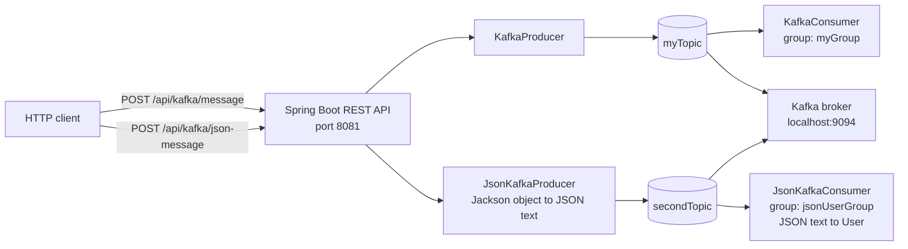
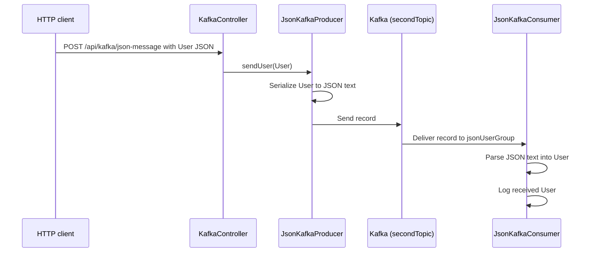
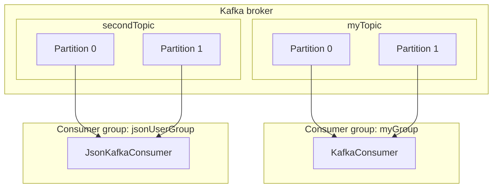

# Kafka Project Notes

## Application setup

- Spring Boot application, using Java 17.
- HTTP server port: `8081`.
- Kafka bootstrap server in `src/main/resources/application.yaml`: `localhost:9094`.
- The app is intended to run on the host while Kafka runs in Docker. The broker must publish a host-accessible listener on port `9094`.
- The workspace could not access the local Docker daemon or connect to `localhost:9094`; verify broker connectivity from the Mac terminal.

## Run the project end to end

### Prerequisites

- Java 17.
- Maven (or use the Maven wrapper if one is added to the repository).
- Docker Desktop running on the Mac.
- Kafka configured with a host-accessible listener on `localhost:9094`.

### 1. Start Kafka and Kafka UI

Start your existing Kafka and Kafka UI containers using the Docker Compose file or run command you already use. This repository does not include a Docker Compose file, so the exact container command depends on your Kafka image and listener configuration.

Confirm the containers and host port mapping from the Mac terminal:

```bash
docker ps
```

The Kafka broker needs to publish port `9094` to the host, and its advertised listener for host clients must also resolve to `localhost:9094`. Kafka UI usually uses the Docker network address of the broker, which may differ from the host address.

### 2. Check the project configuration

Review `src/main/resources/application.yaml`. The app currently expects:

```yaml
spring:
  kafka:
    bootstrap-servers:
      - localhost:9094
    topic: myTopic
    json-topic: secondTopic
    consumer:
      group-id: myGroup
      json-group-id: jsonUserGroup
```

If your Kafka host port differs, update the broker address in this file. Producer and consumer addresses are also specified in their respective sections; keep them consistent with `spring.kafka.bootstrap-servers`.

### 3. Build and start Spring Boot

From the project root (`kafka001`):

```bash
mvn -q -DskipTests compile
mvn spring-boot:run
```

Wait for the startup log indicating Tomcat is running on port `8081`. Leave this terminal open while using the API. Stop the app with **Ctrl+C**.

The app can start its HTTP server even when Kafka is unreachable, but Kafka operations and topic creation will fail or keep retrying until the broker is reachable. Check startup logs for broker connection warnings.

### 4. Send a text message

In another terminal, send a request to the text endpoint:

```bash
curl -i -X POST http://localhost:8081/api/kafka/message \
  -H 'Content-Type: application/json' \
  -d '{"message":"hello Kafka"}'
```

The message is published to `myTopic`; the `KafkaConsumer` application log should show it.

### 5. Send a JSON user

```bash
curl -i -X POST http://localhost:8081/api/kafka/json-message \
  -H 'Content-Type: application/json' \
  -d '{"id":1,"firstName":"Mohammad","lastName":"Mateen"}'
```

The user is serialized to JSON text and published to `secondTopic`. The JSON listener log should show the parsed `User`. In Kafka UI, open the cluster, select **Topics**, open `secondTopic`, then browse its messages to inspect the JSON value.

### 6. Read messages from a Kafka container (optional)

The CLI executable name and path vary by Kafka Docker image. First inspect the image and locate the CLI inside the container:

```bash
docker inspect kafka --format 'Image={{.Config.Image}} Path={{.Path}}'
docker exec kafka sh -lc 'command -v kafka-console-consumer || find / -name "kafka-console-consumer*" 2>/dev/null | head -10'
```

Use the path returned by the second command. For example, if it returns `/opt/kafka/bin/kafka-console-consumer.sh`, run:

```bash
docker exec -it kafka /opt/kafka/bin/kafka-console-consumer.sh \
  --bootstrap-server localhost:9092 \
  --topic secondTopic \
  --from-beginning
```

Inside the Kafka container, the broker address is often `localhost:9092`, but use the address appropriate for your image and broker listener setup. Do not copy this example if the script path or internal listener differs.

### Troubleshooting checklist

- **`kafka-console-consumer.sh: command not found` on the Mac:** The Kafka CLI is not installed on the host. Run it in a Kafka container, using the CLI path inside that image.
- **Docker `exec` reports no such file:** Inspect the image and locate the CLI path as shown above; image layouts differ.
- **Connection refused or repeated broker warnings:** Check `docker ps` port mappings and the Kafka advertised listener. The app on the host uses `localhost:9094`; a CLI inside the Kafka container may use `localhost:9092` or the service name.
- **Messages appear with null fields:** Send JSON field names matching the `User` class: `id`, `firstName`, and `lastName`.
- **Messages don’t reappear after restart:** Consumer groups remember committed offsets. `earliest` only applies when the group has no valid committed offset. Use Kafka UI or a new group ID to inspect from the beginning without changing an existing group’s position.
- **Spring startup error mentions SpEL or `__listener`:** The current `@KafkaListener` annotations use `${...}` YAML placeholders. Avoid `#{__listener...}` with private fields unless exposing readable properties for SpEL.

## Architecture



Both topics live on the same Kafka broker. The producer selects the topic; consumers subscribe to a topic and read records from its partitions.

### Message flow



## Kafka configuration

Current settings are in `src/main/resources/application.yaml`:

- Text topic: `spring.kafka.topic` (`myTopic`).
- JSON topic: `spring.kafka.json-topic` (`secondTopic`).
- Text consumer group: `spring.kafka.consumer.group-id` (`myGroup`).
- JSON consumer group: `spring.kafka.consumer.json-group-id` (`jsonUserGroup`).
- Consumer offset reset: `earliest`.
- Producer and consumer values use Kafka string serializers/deserializers. The JSON flow serializes/deserializes JSON text with Jackson in the producer and consumer classes.

Topic creation is configured in `KafkaTopicConfig`; both topic names are injected into private fields with `@Value` and read from YAML.

## HTTP endpoints

Base path: `http://localhost:8081/api/kafka`

### Send text

`POST /message`

```json
{
  "message": "hello Kafka"
}
```

Publishes a string to the configured `myTopic` topic.

### Send a JSON user

`POST /json-message`

```json
{
  "id": 1,
  "firstName": "Mohammad",
  "lastName": "Mateen"
}
```

Publishes JSON text to the configured `secondTopic` topic. `User` fields are `id`, `firstName`, and `lastName`.

## Consumers

- `KafkaConsumer` listens to the configured text topic and logs strings.
- `JsonKafkaConsumer` listens to the configured JSON topic, parses each string as a `User` with Jackson, and logs it.
- The JSON consumer group is separate from the text consumer group so the two listeners have independent Kafka offsets and assignments.

## Kafka theory notes

- **Broker:** A Kafka server that accepts and stores records. This app connects to the broker at `localhost:9094` from the host machine.
- **Topic:** A named stream of records. This app uses `myTopic` for text and `secondTopic` for JSON user messages.
- **Partition:** A topic is split into ordered logs called partitions. Ordering is guaranteed within one partition; records across different partitions do not have a single total order. Kafka chooses a partition based on the record key, if provided, or its partitioning strategy otherwise.
- **Producer:** An application component that writes records to Kafka. Here, `KafkaProducer` writes text and `JsonKafkaProducer` converts a `User` into JSON text before writing it.
- **Consumer:** An application component that reads records from Kafka. Here, the text listener reads strings, and the JSON listener parses JSON strings into `User` objects.
- **Serialization:** Kafka stores bytes. Producer serializers turn application values into bytes; consumer deserializers turn bytes back into values. This project uses string serialization at the Kafka boundary, with Jackson handling the JSON conversion in Java code.
- **Consumer group:** Consumers with the same group ID share work and maintain offsets as a group. Each partition is assigned to at most one consumer in a group at a time. Separate groups each receive their own view of the topic and track offsets independently.
- **Offset:** The position of a record in a partition. Kafka commits offsets for each consumer group so it can resume after restart. `auto-offset-reset: earliest` applies when a group has no committed offset (or its offset is unavailable); it does not rewind a group that already has committed offsets.
- **Acknowledgment and delivery:** A successful call to `KafkaTemplate.send()` is asynchronous. Logging immediately after it means the send was requested, not necessarily confirmed by the broker. For stronger API guarantees, observe the returned future and report success/failure based on its completion.
- **Topic creation:** `KafkaTopicConfig` declares `NewTopic` beans. Spring Kafka's `KafkaAdmin` can create those topics on startup when it can connect to the broker and the broker permits topic creation.

### Topic and consumer group view



The diagram shows the general assignment model; the current topic configuration creates topics with Kafka's default partition count, and a single listener instance can receive multiple partitions.

## Kafka UI and console consumer

In Kafka UI, select the Kafka cluster, open **Topics**, select `secondTopic`, then view/browse messages. The JSON value should contain the submitted user fields.

The host command `kafka-console-consumer.sh` was not found on the Mac. A Docker `exec` command depends on the Kafka image and the script path inside it; previous guesses for `/opt/kafka/bin/...` did not work. Identify the image and executable path before choosing a command:

```bash
docker inspect kafka --format 'Image={{.Config.Image}} Path={{.Path}}'
docker exec kafka sh -lc 'command -v kafka-console-consumer || find / -name "kafka-console-consumer*" 2>/dev/null | head -10'
```

## Startup troubleshooting

The app initially failed during startup because `@KafkaListener` used SpEL expressions like `#{__listener.topic}` to read private fields without getters. The listeners now use YAML property placeholders directly in `@KafkaListener` (`${spring.kafka...}`); keep those annotations as placeholders.

The app then passed Spring context initialization and initialized Tomcat on port `8081`. Kafka connectivity was not confirmed from the workspace: attempting `localhost:9094` returned `Operation not permitted` due to workspace network restrictions. Check the Docker broker's host port mapping and advertised listener from the Mac.

## Build check

Compile the project with:

```bash
mvn -q -DskipTests compile
```

The compile check passed after the last code changes. No automated tests were run.
